<!-- readme-atelier:start -->
<!-- Generated by Readme Atelier (https://github.com/monokernn/readme-atelier). Edit atelier.yml instead of this block. -->

<picture><source media="(prefers-color-scheme: dark)" srcset="./atelier/header-dark.svg"/></picture>

  <a href="https://github.com/nftmindzone"><picture><source media="(prefers-color-scheme: dark)" srcset="./atelier/social-github-dark.svg"/></picture></a>

  <picture><source media="(prefers-color-scheme: dark)" srcset="./atelier/stats-dark.svg"/></picture>
  <picture><source media="(prefers-color-scheme: dark)" srcset="./atelier/languages-dark.svg"/></picture>

<picture><source media="(prefers-color-scheme: dark)" srcset="./atelier/activity-dark.svg"/></picture>

  <a href="https://github.com/nftmindzone/cursor"><picture><source media="(prefers-color-scheme: dark)" srcset="./atelier/repo-1-dark.svg"/></picture></a>
  <a href="https://github.com/nftmindzone/imdb"><picture><source media="(prefers-color-scheme: dark)" srcset="./atelier/repo-2-dark.svg"/></picture></a>

<picture><source media="(prefers-color-scheme: dark)" srcset="./atelier/stack-dark.svg"/></picture>

<picture><source media="(prefers-color-scheme: dark)" srcset="./atelier/footer-dark.svg"/></picture>

<!-- readme-atelier:end -->
